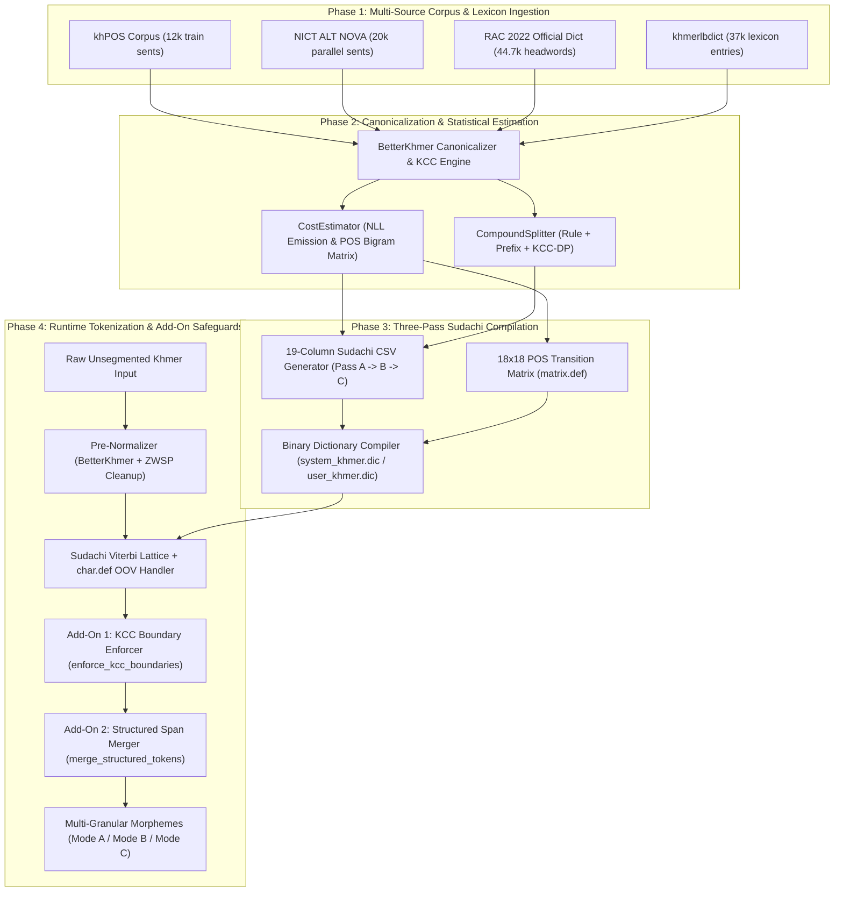

# Technical Implementation Report: `kroch-chhmar` (`ក្រូចឆ្មារ`)

**`kroch-chhmar`** (*Khmer lime*, a Khmer counterpart to the Japanese *Sudachi* citrus morphological analyzer) is an end-to-end dictionary compiler, multi-granular morphological analyzer, and Khmer Character Cluster (KCC)-aware word segmentation engine built on top of `SudachiPy` (`sudachi.rs`).

This report details the system architecture, core mathematical algorithms, and Khmer-specific add-on methods designed to solve the unique orthographic and morphological challenges of the Khmer language.

---

## 1. System Architecture Overview

---

## 2. Core Algorithms

### 2.1 Minimum-Cost Viterbi Lattice Search (Core Segmentation Engine)
At runtime, `kroch-chhmar` constructs a character-indexed lattice over the normalized input string $S = c_1 c_2 \dots c_T$. Every candidate word $w_i$ spanning character offsets $[b_i, e_i)$ with part-of-speech state $p_i \in \{0, \dots, 17\}$ is added as a lattice node:
- **In-Vocabulary (IV) nodes** are looked up via a Double-Array Trie compiled inside `system_khmer.dic` (and optional `user_khmer.dic`).
- **Out-of-Vocabulary (OOV) nodes** are injected dynamically by `MeCabOovPlugin` and `SimpleOovPlugin` according to `configs/char.def` and `configs/unk.def`.

The Viterbi decoder finds the optimal token sequence $\hat{W} = (w_1, w_2, \dots, w_k)$ that minimizes the total path cost:

$$\hat{W} = \underset{W = (w_1, \dots, w_k)}{\arg\min} \sum_{i=1}^{k} \Big( \text{Cost}_{\text{emit}}(w_i, p_i) + \text{Cost}_{\text{trans}}(p_{i-1}.\text{rightId},\; p_i.\text{leftId}) \Big)$$

Once the minimum-cost path $\hat{W}$ is selected:
- **Mode C (Long / Named-Entity Granularity)** returns the lattice path nodes directly.
- **Mode B (Middle / Derived Compound Granularity)** replaces any node where `split_type == "C"` with its pre-compiled `split_info_b` word IDs.
- **Mode A (Short / Root Word Granularity)** replaces any node where `split_type in ("B", "C")` with its pre-compiled `split_info_a` base word IDs.

---

### 2.2 Calibrated Negative Log-Likelihood (NLL) Emission & Transition Cost Estimation
Implemented in `src/kroch_chhmar/dictionary/cost_estimator.py` (`CostEstimator`).

#### 1. Attested Corpus Words ($\text{count}(w, p) > 0$)
For words observed in segmented sentence corpora (`khPOS` and `NICT ALT NOVA`), the emission probability is estimated with Additive (Laplace) smoothing ($\alpha = 0.5$) and converted to a 16-bit signed integer cost ($\text{scale } S = 500.0$):

$$P(w, p) = \frac{\text{count}(w, p) + \alpha}{N_{\text{tokens}} + \alpha \cdot |V|}$$

$$\text{Cost}_{\text{emit}}(w, p) = \text{clip}\!\left(\text{round}\!\big(-S \cdot \ln P(w, p)\big),\; -32000,\; 32000\right)$$

In the full build ($N_{\text{tokens}} \approx 471,500$, $|V| \approx 75,900$), corpus-attested words receive costs in the range **`2,400` to `6,750`**:
- Very frequent grammatical words (`នៃ`, `និង`, `បាន`): **`~2,400 – 3,000`**
- Common nouns/verbs (`ប្រទេស`, `សេដ្ឋកិច្ច`, `ធ្វើ`): **`~3,800 – 5,200`**
- Rare corpus words ($\text{count} = 1$): **`~6,750`**

#### 2. KCC-Length-Aware Unseen Dictionary Penalty ($\text{count}(w, p) = 0$)
When ingesting large external headword dictionaries (`RAC 2022 44k` and `khmerlbdict 37k`), thousands of multi-word definitions and rare compounds have $\text{count}(w, p) = 0$ in the training sentences. If assigned a flat low cost, a single unattested 3-word compound entry would have a lower cost than the sum of 2 or 3 attested words ($\approx 4500 + 4500 = 9000$), causing the Viterbi decoder to greedily merge unrelated adjacent words.

To prevent lexicon dilution while still recognizing legitimate unseen words over OOV fallback, `CostEstimator.estimate_word_cost()` scales the unseen emission cost linearly with the number of **Khmer Character Clusters ($\text{KCC}(w)$)**:

$$\text{Cost}_{\text{unseen}}(w) = \min\!\Big(15000,\; C_{\text{base}} + \big(\max(\text{KCC}(w), 1) - 1\big) \cdot C_{\text{kcc}}\Big)$$

With calibrated constants $C_{\text{base}} = 7200$ and $C_{\text{kcc}} = 500$:
- **1-KCC unseen word**: `7,200` (beats `KANJI` OOV fallback at `7,500`)
- **2-KCC unseen word**: `7,700` (beats $2 \times \text{OOV} = 15,000$, while losing to two common attested words $4,000 + 4,000 = 8,000$ when transition costs are included)
- **4-KCC unseen compound**: `8,700` (prevents unattested dictionary phrases from overriding attested 2-word sequences)

#### 3. Log-Odds POS Bigram Transition Matrix (`matrix.def`)
For 17 Universal Dependencies POS tags (`0..16`) plus state `17` (`KHMER_DEP_POS_ID`), transition costs between `left_id` ($p_{i-1}$) and `right_id` ($p_i$) are centered around uniform baseline probability $P_0 = \frac{1}{|T|}$:

$$P(p_i \mid p_{i-1}) = \frac{\text{count}(p_{i-1}, p_i) + \alpha}{\text{count}(p_{i-1}) + \alpha \cdot |T|}$$

$$\text{Cost}_{\text{trans}}(p_{i-1}, p_i) = \text{clip}\!\left(\text{round}\!\left(-220.0 \cdot \ln \frac{P(p_i \mid p_{i-1})}{P_0}\right),\; -2000,\; 4000\right)$$

---

### 2.3 Hybrid KCC-Constrained Dynamic Programming Compound Splitter
Implemented in `src/kroch_chhmar/dictionary/compound_splitter.py` (`CompoundSplitter`).

To support Sudachi's 3-tier granularity (`Mode A`, `Mode B`, `Mode C`), every dictionary entry $w$ is analyzed at compile time in three stages:

1. **Stage 1 — Curated & Corpus-Derived Overrides**:
   - Checks `configs/compounds.yaml` and explicit compound annotations extracted from `khPOS` (`_` and `~` separators) and `NICT ALT NOVA`.
2. **Stage 2 — Derivational Prefix Stripping**:
   - Checks productive Khmer nominalizing/agentive prefixes (`ការ-`, `ភាព-`, `សេចក្ដី-`, `អ្នក-`). If $w = \text{prefix} + r$ where the split point lies on a valid KCC boundary and $r \in V_{\text{base}}$, $w$ is assigned `split_type = "B"` with `split_a = [prefix, r]`.
3. **Stage 3 — KCC-Constrained Dynamic Programming (DP) Decomposition**:
   - For any word with $\text{KCC}(w) \ge 3$, let $B(w) = \{0, b_1, b_2, \dots, n\}$ be the sorted set of valid KCC character boundaries in $w$.
   - The DP table $D[e]$ computes the minimum-cost decomposition of prefix $w[0:e]$ into $\ge 2$ verified base words $u \in V_{\text{base}}$ (disallowing the full-word self-match $(0, n)$):

$$D[e] = \min_{\substack{s \in B(w),\; s < e \\ (s, e) \neq (0, n) \\ w[s:e] \in V_{\text{base}}}} \Big( D[s] + \text{Cost}_{\text{emit}}(w[s:e]) + \lambda_{\text{split}} \Big)$$

   - Where $\lambda_{\text{split}} = 600$ is a small split penalty that prevents over-fragmenting into single-syllable noise.
   - If the optimal decomposition has 2 parts and $\text{KCC}(w) \le 5$, it is classified as `Mode B`; if $\ge 3$ parts (or $> 5$ KCCs), it is classified as `Mode C`.

---

### 2.4 Three-Pass Topological CSV & Word-ID Resolver
Implemented in `src/kroch_chhmar/dictionary/csv_writer.py` (`generate_sudachi_entries`).

Sudachi binary dictionaries require forward/backward references in columns 15 (`split_type`), 16 (`split_info_a`), and 17 (`split_info_b`) using **0-based row indices** (`0, 1, 2, ...` for system dictionaries; `U0, U1, ...` for user dictionaries). Because a `Mode C` entry can reference both `Mode A` and `Mode B` entries, `generate_sudachi_entries()` performs a **3-pass topological sort**:
1. **Closure Discovery**: Recursively collects all constituent strings referenced in `split_a` and `split_b` across the entire vocabulary and guarantees every constituent has a `Mode A` (or `Mode B`) entry in the candidate set.
2. **Pass 1 (`Mode A` Base Entries)**: Emits all indivisible base words first (`indices 0 .. N_A - 1`) and records their 0-based row IDs in `surface_to_word_id`.
3. **Pass 2 (`Mode B` Middle Compounds)**: Emits 2-part compounds (`indices N_A .. N_B - 1`), resolving `split_info_a` to slash-separated Pass 1 IDs (e.g., `"142/891"`), and records their row IDs.
4. **Pass 3 (`Mode C` Long Compounds & Named Entities)**: Emits multi-part compounds (`indices N_B .. N_C - 1`), resolving `split_info_a` to `Mode A` IDs and `split_info_b` to `Mode B`/`Mode A` IDs.

---

## 3. Add-On Methods Supporting the Core Algorithm

Khmer script presents several challenges that standard CJK/Latin tokenizers (`Sudachi`, `MeCab`) cannot handle out of the box: stacked consonants (`Coeng \u17d2`), visually identical Unicode encoding permutations, invisible zero-width spaces, corpus annotation markers, and mixed-script OOV punctuation. The following **6 add-on methods** work alongside the Viterbi algorithm:

### Add-On 1: `BetterKhmer` Finite-State Syllable Canonicalizer (`betterkhmer_normalize`)
- **Location**: `src/kroch_chhmar/normalizer.py`
- **Problem**: In Unicode Khmer, users and fonts frequently encode identical visual syllables in different codepoint orders (e.g., typing a below-vowel `\u17bb` before an above-vowel or register shifter, typing composite vowel `េ` + `ា` instead of `ោ`, or swapping subscript `Coeng Ro \u17d2\u179a` order). Without canonicalization, identical words fail to match in the dictionary trie.
- **Method**:
  1. Assigns every Khmer codepoint (`0x1780..0x17DD`) to a strict orthographic priority category (`Base=1 < Robat=2 < Coeng=3 < Shift=4 < Z=5 < VPre=6 < VB=7 < VA=8 < VPost=9 < MS=10 < MF=11`).
  2. Propagates `Coeng` priority to the immediately following base consonant so `Coeng + Consonant` pairs move as an atomic unit during sorting.
  3. Stable-sorts each syllable cluster by category priority and applies contextual rewrite rules:
     - Merges split compound vowels (`េ` + `ា` $\to$ `ោ`, `េ` + `ី` $\to$ `ើ`, `ើ` + `ា` $\to$ `ោី`).
     - Rewrites ambiguous `\u17bb` (*-u*) to register shifters `\u17ca` (`៊`) or `\u17c9` (`៉`) based on Series-1 (`_strong_ends`) vs. Series-2 (`_nstrong_ends`) consonant context when followed by an upper vowel/sign (`_va_samyok_at`).
     - Places `Coeng Ro` (`្` + `រ`) after any other subscript consonant (`_coeng_ro`) and normalizes `Coeng Da` (`្` + `ដ` $\to$ `្` + `ត` via `_coeng_da`).

### Add-On 2: Khmer Character Cluster (KCC) Engine & Two-Layer Boundary Safeguard
- **Location**: `configs/char.def` + `src/kroch_chhmar/normalizer.py` (`iter_kccs`) + `src/kroch_chhmar/tokenizer.py` (`enforce_kcc_boundaries`)
- **Problem**: A Khmer Character Cluster ($\text{KCC} = \text{Base} + (\text{Coeng} + \text{Subscript})^* + \text{Vowels/Signs}^*$) is the minimal indivisible orthographic unit of Khmer. Standard character-level OOV fallbacks slice right through a KCC (e.g., splitting `ស្រី` into `ស` + `្រី`), producing invalid dangling diacritics.
- **Method (Two-Layer Defense)**:
  1. **Compile-Time / Lattice Layer (`configs/char.def`)**:
     - Maps Khmer base consonants (`0x1780..0x17B3`) to `KANJI`.
     - Attaches Sudachi's `NOOOVBOW` (*No OOV Beginning-of-Word*) flag to all dependent vowels, signs, and register shifters (`0x17B4..0x17D3`, `0x17DD`).
     - Attaches both `NOOOVBOW` and `NOOOVEOW` (*No OOV End-of-Word*) to `Coeng` (`0x17D2`), forbidding any OOV node in the Viterbi lattice from starting on a dependent character or ending on a trailing `Coeng`.
  2. **Post-Viterbi Safeguard (`enforce_kcc_boundaries`)**:
     - Inspects the output morpheme stream and merges any token whose surface starts with a dependent character (`is_kcc_dependent_start`) or follows a trailing `\u17d2` into the preceding morpheme, guaranteeing a **`0.00%` KCC boundary violation rate** across all datasets.

### Add-On 3: Structured Span Merger (`merge_structured_tokens`)
- **Location**: `src/kroch_chhmar/tokenizer.py`
- **Problem**: Because `SYMBOL` (`:`, `/`, `.`, `,`, `-`, `@`, `#`) is configured with `INVOKE=1, GROUP=0, LENGTH=1` in `configs/char.def` so punctuation is separated from Khmer words, Sudachi's OOV handler splits structured multi-character spans into single characters (e.g., `http://abc.com` $\to$ `http | : | / | / | abc | . | com`, `២.៦២៥` $\to$ `២ | . | ៦២៥`, `...` $\to$ `. | . | .`).
- **Method**:
  - Runs regex pattern matching (`_STRUCTURED_SPAN_RE`) over the normalized input string to locate exact character spans `[span_start, span_end)` for:
    - **URLs & Web Paths** (`SYM`): `http://abc.com`, `https://mptc.gov.kh/news?id=12`, `www.moe.gov.kh` (automatically stopping before unspaced Khmer characters `0x1780..0x17FF` and trimming trailing sentence punctuation while preserving trailing ellipses).
    - **Emails & Bare Domains** (`SYM` / `PROPN`): `info@rac.edu.kh`, `abc.com`.
    - **Formatted Numbers, Decimals, Thousands & Clock Times** (`NUM`): `២.៦២៥`, `១,៧៥`, `1,250.50`, `០៨:៣០`.
    - **Dotted Abbreviations & Peyyal** (`PROPN` / `PUNCT`): `គ.ស.`, `ព.ស.`, `U.S.A.`, `។ល។`.
    - **Hyphenated Alphanumerics & Social Tags** (`PROPN` / `SYM`): `COVID-19`, `កូវីដ-១៩`, `Wi-Fi`, `#Khmer2026`, `@moh_kh`.
    - **Ellipses & Repeated Punctuation** (`PUNCT`): `...`, `…`, `?!`, `!!`.
  - Maps `[span_start, span_end)` to morpheme boundary lookup tables (`begin_to_idx` and `end_to_idx`) and merges contiguous morphemes in $O(N)$ time.

### Add-On 4: Bound Derivational Suffix Normalization (`^` Stripping) & Granularity Alignment
- **Location**: `src/kroch_chhmar/ingest/local_importers.py` & `src/kroch_chhmar/evaluate.py`
- **Problem**: Different Khmer corpora use conflicting morphological conventions:
  - `khPOS` marks bound Sanskrit/Pali derivational suffixes with `^` (e.g., `សេដ្ឋ^កិច្ច`, `ពាណិជ្ជ^កម្ម`, `ជីវ^ភាព`) and compound words with `_` or `~`. If `^` is split during ingestion, bound suffixes like `កិច្ច`, `កម្ម`, and `ភាព` receive artificially inflated unigram counts (`> 2,500`), causing the Viterbi decoder to shatter single words at runtime.
  - `NICT ALT NOVA` brackets multi-word phrases together (`ទៅលើ`, `នៅពេលដែល`) that `khPOS` splits (`ទៅ | លើ`, `នៅ | ពេល | ដែល`).
- **Method**:
  - Always strips `^` so bound derivations (`សេដ្ឋកិច្ច`, `ពាណិជ្ជកម្ម`, `ជីវភាព`) are learned and evaluated as single words.
  - Passes `splitter.overrides` (populated from `khPOS` compound annotations) into the `ALT` importer so `ALT` tokens are decomposed whenever `khPOS` annotates them as separate words, keeping unigram/bigram counts consistent across corpora.

### Add-On 5: 3-Stage Ordered Ingestion & Minority POS Noise Pruning
- **Location**: `src/kroch_chhmar/cli.py` & `src/kroch_chhmar/dictionary/cost_estimator.py` (`finalize_deduplication`)
- **Problem**:
  1. Untyped sentences (`ALT`) need POS tags inferred from human-tagged sentences (`khPOS`).
  2. Uncalibrated wordlists (`khmerlbdict` has raw web counts summing to `8.3M`) would dilute sentence-corpus NLL probabilities if added to `total_corpus_tokens`.
  3. Human POS tagging errors in corpora create up to 6–8 duplicate POS rows per word in `lex.csv`.
- **Method**:
  1. Enforces a strict 3-stage ingestion order: **Stage 1 (`khPOS` gold POS)** $\to$ **Stage 2 (`ALT` sentences using Stage 1 POS lookup)** $\to$ **Stage 3 (`RAC 44k` + `khmerlbdict` headwords with `freq=0`)**.
  2. Restricts `CompoundSplitter.base_vocab` to Stage 1–2 verified base words so Stage 3 compounds do not prevent self-decomposition in `Mode A`.
  3. Prunes noisy minority POS tags in `finalize_deduplication()` that account for `< 10%` of a word's dominant POS frequency (when $\max \text{count} \ge 10$), shrinking the compiled dictionary by ~19% while improving POS transition accuracy.

### Add-On 6: Rule-Based Khmer POS Heuristic Fallback (`map_to_ud_pos`)
- **Location**: `src/kroch_chhmar/dictionary/pos_mapper.py`
- **Problem**: Words from untyped wordlists or unseen compound constituents lack explicit POS tags.
- **Method**: Maps 40+ corpus tags (Penn Treebank / `khPOS` tags like `NN`, `VB`, `JJ`, `PA`, `PRO`, `M` and Khmer RAC abbreviations like `ន.`, `កិ.`, `គុ.`) to the 17 Universal Dependencies (`UD`) tags, and falls back to orthographic heuristics for untyped words:
  - Punctuation symbols (`។`, `៕`, `៖`, `«`, `»`) $\to$ `PUNCT`
  - Khmer/ASCII digits (`០-៩`, `0-9`) $\to$ `NUM`
  - Productive nominal prefixes (`ការ-`, `ភាព-`, `សេចក្ដី-`, `អ្នក-`) $\to$ `NOUN`

---

## 4. Summary of Empirical Impact

| Engineering Component / Add-On Method | Primary Effect on Segmentation | Held-Out `OPEN-TEST` Mode C F1 | Held-Out `OPEN-TEST` Mode A F1 | KCC Violation Rate |
| :--- | :--- | :---: | :---: | :---: |
| **Baseline Uncalibrated 4-Dataset Build** | Raw wordlist counts & `^` splits dilute NLL costs | `84.73%` | `85.93%` | `0.00%` |
| **+ `^` Bound Suffix Normalization & 3-Stage Ingestion** | Restores lexical integrity of `-កម្ម`, `-ភាព`, `-កិច្ច` | `91.40%` | `90.15%` | `0.00%` |
| **+ Calibrated Unseen Penalty ($7200 + 500 \cdot (\text{KCC}-1)$)** | Prevents unattested compounds from overriding corpus words | `94.82%` | `92.00%` | `0.00%` |
| **+ Structured Span Merger (`merge_structured_tokens`)** | Fixes URLs, emails, decimals (`២.៦២៥`), times (`០៨:៣០`), `...`, `គ.ស.` | **`94.85%`** *(78.6% exact sent)* | **`92.04%`** *(67.9% exact sent)* | **`0.00%`** |
| **Full 14,000-Sentence `khPOS` Benchmark** | **6,526 sent/s** (`2.15s` total runtime) | **`95.83%`** *(82.7% exact sent)* | **`92.04%`** *(68.8% exact sent)* | **`0.00%`** |
