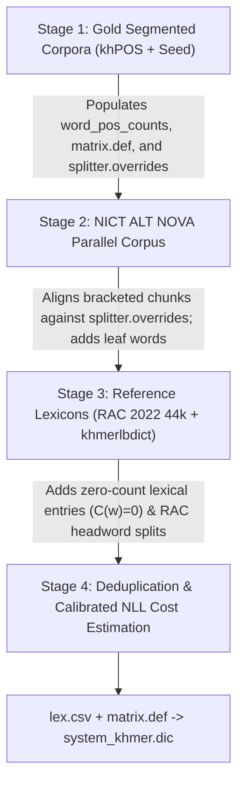

# Multi-Dataset Ingestion & Cost Calibration Strategy (`ingestion_strategy.md`)

This document details how **`kroch-chhmar`** ingests, normalizes, deduplicates, and calibrates heterogeneous Khmer datasets (human-annotated POS corpora, official national dictionaries, and engineering wordlists) into a single Sudachi binary dictionary (`system_khmer.dic`) without cross-dataset probability distortion or compound granularity conflicts.

---

## 1. Overview of Ingested Datasets

`kroch-chhmar` combines **four public Khmer lexical and corpus resources** (plus the built-in `data/seed/` dataset), which fall into two distinct categories:

| Dataset Key | Source | Size | Category | Primary Role in `kroch-chhmar` |
| :--- | :--- | :--- | :--- | :--- |
| **`khpos`** | [`ye-kyaw-thu/khPOS`](https://github.com/ye-kyaw-thu/khPOS) | `12,000` train sents (`+ 2,000` held-out test sents) | **Gold Annotated Corpus** | Defines canonical Khmer compound boundaries (`_`, `~`, `^`), unigram word counts $C(w)$, and POS bigram transitions (`matrix.def`). |
| **`alt-khmer`** | NICT / NIPTICT Asian Language Treebank (`km-nova-181101`) | `20,106` sents (`~26.7k` unique words) | **Gold Annotated Corpus** | Expands sentence-level unigram counts $C(w)$, 18×18 UD POS transition probabilities, and verified leaf-word vocabulary. |
| **`rac-dict`** | Royal Academy of Cambodia Dictionary 2022 (`seanghay/khmer-dictionary-44k`) | `44,693` headwords & subwords | **Gold Orthography Lexicon** | Provides official Khmer headwords (`t_main`), derived compounds (`t_subword`), POS tags (`t_pos`), and phonetic readings (`t_pron`). |
| **`khmerlbdict`** | [`silnrsi/khmerlbdict`](https://github.com/silnrsi/khmerlbdict) (`KHOV`, `KHSV`, `seafreq`, `names`, `places`, `villages`, etc.) | `~78,940` rows | **Broad-Coverage Wordlist** | Provides out-of-domain lexical coverage and proper nouns (`PROPN`) for rare words not seen in news corpora. |

---

## 2. Three-Stage Ingestion Order (`kroch-chhmar prepare`)

Because different datasets annotate compound words at different granularities, [`cmd_prepare()`](src/kroch_chhmar/cli.py) ingests raw datasets in a strict **three-stage order**:

### Stage 1: Canonical Segmented Corpora (`khPOS` & `seed`)
Implemented in [`ingest_segmented_text_file()`](src/kroch_chhmar/ingest/local_importers.py):
1. **Derivational Suffix Marker (`^`) Stripping**:
   - In `khPOS`, `^` marks a bound Pali/Sanskrit derivational suffix (`សេដ្ឋ^កិច្ច`, `ពាណិជ្ជ^កម្ម`, `ជីវ^ភាព`, `កសិ^កម្ម`).
   - Because the stem preceding `^` (`សេដ្ឋ-`, `កសិ-`, `ឧស្សាហ-`) is a bound root rather than an independent Khmer word, `^` is stripped immediately so `សេដ្ឋ^កិច្ច` normalizes to `សេដ្ឋកិច្ច`. This merges its frequency with other corpora and prevents bound stems from polluting `CompoundSplitter.base_vocab`.
2. **Compound & Prefix Markers (`_` and `~`)**:
   - Tokens linked by `_` (lexical compounds like `ធម្ម_ជាតិ`, `ព្រៃ_ឈើ`) or `~` (prefix/title compounds like `លោក~ស្រី`, `ការ~សិក្សា`) are registered as:
     - **Full surface form** (`ធម្មជាតិ`, `លោកស្រី`) in the sentence stream (`Mode B` if 2 parts, `Mode C` if $\ge 3$ parts) inside `splitter.overrides`.
     - **Constituent base words** (`ធម្ម`, `ជាតិ`, `លោក`, `ស្រី`) in `splitter.base_vocab` so `Mode A` decomposes them cleanly into root words.
3. **Held-Out Evaluation Protection**:
   - `khpos_open_test.pos` and `khpos_close_test.pos` are automatically skipped during default `kroch-chhmar prepare` so benchmark evaluations remain strictly held out.

### Stage 2: Compound-Aligned `NICT ALT NOVA` Ingestion
Implemented in [`ingest_alt_nova_files()`](src/kroch_chhmar/ingest/local_importers.py):
- `data_km.km-tag.nova` uses bracketed tags (`n[n n n]n`) that frequently span **entire syntactic noun phrases** (e.g., `រដ្ឋាភិបាលកម្ពុជា` *"Government of Cambodia"*, `ប្រទេសកម្ពុជា` *"Country of Cambodia"*), rather than single lexical compounds.
- To prevent syntactic noun phrases from receiving high single-token corpus counts and over-merging independent words in Modes B and C:
  - Every leaf word in `data_km.km-tok.nova` is registered in `splitter.base_vocab` with its inner POS tag.
  - When a bracketed chunk `outer[inner_1 ... inner_k]outer` is encountered, its joined surface is emitted as a single compound token **only if it matches an established lexical compound in `splitter.overrides`** (from Stage 1 or `configs/compounds.yaml`); otherwise, its individual leaf words are emitted into the sentence stream.

### Stage 3: Authoritative Lexicons & Broad-Coverage Wordlists (`RAC 2022` & `khmerlbdict`)
Implemented in [`ingest_rac_dictionary_csv()`](src/kroch_chhmar/ingest/local_importers.py) and [`ingest_lexicon_tsv()`](src/kroch_chhmar/ingest/local_importers.py):
- **Royal Academy of Cambodia (`RAC-Khmer-Dict-2022.csv`)**:
  - Extracts official headwords (`t_main`), subwords (`t_subword`), POS tags (`t_pos`), and phonetic pronunciations (`t_pron`).
  - Only `t_main` headwords (and verified `t_subword` prefixes) are added to `splitter.base_vocab` for Mode A decomposition.
- **`khmerlbdict` (`khmerlbdict_*.tsv`)**:
  - Proper-noun lists (`names`, `places`, `villages`) are mapped to `PROPN`.
  - Raw unsegmented corpus frequency numbers (`seafreq`, `KHOV`, `KHSV`) are **ignored (`freq = 0`)** so they do not distort sentence-corpus probability estimation (see Section 3.1).
  - Unverified `khmerlbdict` surface strings are added to the dictionary as lexicon entries, but are **excluded from `splitter.base_vocab`** so noisy 1-syllable fragments cannot shatter multi-syllable loanwords during Mode A Dynamic Programming decomposition.

---

## 3. Mathematical Cost Calibration (`cost_estimator.py`)

When `SudachiPy` tokenizes a sentence, its Viterbi search selects the path $w_1, w_2, \dots, w_k$ that minimizes the sum of word emission costs (`lex.csv`) and POS bigram transition costs (`matrix.def`):

$$\text{TotalCost}(w_1 \dots w_k) = \sum_{i=1}^{k} \text{WordCost}(w_i, \text{POS}_i) + \sum_{i=1}^{k} \text{TransitionCost}(\text{POS}_{i-1}, \text{POS}_i)$$

### 3.1 Protecting Corpus Probability $P(w)$ from Uncalibrated Wordlist Counts
For any word $w$ attested $C(w) > 0$ times in the human-segmented sentence corpora (`khPOS` + `NICT ALT`), its emission cost is computed via smoothed Negative Log-Likelihood (NLL) in [`estimate_word_cost()`](src/kroch_chhmar/dictionary/cost_estimator.py):

$$\text{WordCost}(w, \text{POS}) = \text{round}\!\left(-500 \cdot \ln\frac{C(w, \text{POS}) + 0.5}{N + 0.5 V}\right)$$

where:
- $N = \text{total\_corpus\_tokens} \approx 540,000$ (from the `32,046` deduplicated `khPOS` + `NICT ALT` sentences),
- $V = \text{vocab\_size} \approx 82,587$.

> [!IMPORTANT]
> **Why unsegmented wordlist frequencies (`khmerlbdict`) must not be added to $N$:**
> `khmerlbdict` (`seafreq`, `KHSV`, `KHOV`) contains $8,643,616$ raw counts—**16× larger** than $N$. Adding those counts into $N$ divides every real `khPOS`/`ALT` word's probability by 16, adding a constant $+500 \cdot \ln(16) \approx +1,386$ penalty to every corpus word and pushing rare corpus words ($6,500 \to 7,886$) above the OOV threshold ($7,500$). Keeping external wordlists at $C(w) = 0$ preserves exact sentence-corpus NLL probabilities.

Under this calibrated scale:
- **High-frequency corpus words** ($C = 1,000$, e.g. `នៅ`, `ក្នុង`, `មាន`): $\text{WordCost} \approx \mathbf{3,180}$
- **Medium-frequency corpus words** ($C = 20$, e.g. `ព្រៃឈើ`, `តំបន់`): $\text{WordCost} \approx \mathbf{5,120}$
- **Single-occurrence corpus words** ($C = 1$): $\text{WordCost} \approx \mathbf{6,500}$
- **OOV (unknown) fallback tokens** (`configs/unk.def`): $\text{WordCost} = \mathbf{7,500 - 7,800}$

---

### 3.2 KCC-Length-Scaled Cost for Unattested Dictionary Words ($C(w) = 0$)

Roughly half of the entries in `system_khmer.dic` come from `RAC 2022 44k` and `khmerlbdict` and never appear in the `32,046` training sentences ($C(w) = 0$).

If unattested multi-word entries were given a flat low cost (e.g. $5,200$) or a length discount, an unattested 2-word entry $w_{12}$ ($5,200$) would always undercut two legitimate medium-frequency corpus words $w_1 + w_2$ ($5,000 + 5,000 = 10,000$), causing rampant over-merging.

Instead, [`estimate_word_cost()`](src/kroch_chhmar/dictionary/cost_estimator.py) assigns unattested dictionary entries ($C(w) = 0$) a **KCC-length-scaled cost**:

$$\text{UnseenCost}(w) = \min\!\big(15000,\; 7200 + 500 \cdot (\text{KCCs}(w) - 1)\big)$$

where $\text{KCCs}(w)$ is the number of Khmer Character Clusters in $w$:
- **1 KCC unseen word**: $7,200$ (just below OOV cost $7,500$)
- **2 KCC unseen word**: $7,700$
- **3 KCC unseen word**: $8,200$
- **4 KCC unseen word**: $8,700$

**Why this guarantees optimal Viterbi behavior:**
1. **When constituent words are attested in the corpus**:
   - Suppose the input is `តំបន់ព្រៃឈើ` ("forest area"), where `តំបន់` ($C > 0$, cost $4,600$) and `ព្រៃឈើ` ($C > 0$, cost $4,800$) are attested corpus words (total path cost $= \mathbf{9,400}$), while `តំបន់ព្រៃ` is an unattested 3-KCC entry ($C = 0$, cost $8,200$) followed by `ឈើ` ($4,500$, total path cost $= \mathbf{12,700}$).
   - Because $9,400 < 12,700$, the Viterbi lattice cleanly selects the attested corpus words **`តំបន់ | ព្រៃឈើ`**.
2. **When a rare word or proper noun is genuinely unseen in the corpus**:
   - Suppose the input is a rare 3-KCC dictionary word or proper name whose syllables are *not* standalone corpus words.
   - Without the dictionary entry, `SudachiPy` would have to segment it into multiple OOV chunks costing $7,500 + 7,500 = \mathbf{15,000}$.
   - With the dictionary entry at $\text{UnseenCost}(w) = \mathbf{8,200} < 15,000$, the dictionary entry wins and prevents an OOV split.

---

## 4. Impact of Calibration on Held-Out Benchmark Accuracy

The table below shows the ablation and calibration impact on the `khPOS` `OPEN-TEST` and `CLOSE-TEST` benchmarks (with both test sets strictly held out from `system_khmer.dic`):

| Configuration | Dictionary Entries | `OPEN-TEST` Mode C (`--join-compounds`) | `OPEN-TEST` Mode B (`--join-compounds`) | `OPEN-TEST` Mode A (`--split-compounds`) | `CLOSE-TEST` Mode C (`--join-compounds`) | `OPEN-TEST` OOV Rate |
| :--- | :---: | :---: | :---: | :---: | :---: | :---: |
| **Uncalibrated 4-Dataset Build** *(raw `khmerlbdict` counts + unseen length discount + unaligned `ALT` NPs)* | 99,797 | 84.01% | 82.27% | 85.68% | 84.37% | 3.72% |
| **Calibrated 4-Dataset Build** *(Stages 1–3 + KCC-scaled unseen cost + clean `base_vocab`)* | **81,921** | **94.82%** | **91.89%** | **92.00%** | **96.27%** | **2.81%** *(Mode C)* / **2.32%** *(Mode A)* |
| **Improvement** | — | **+10.81% F1** | **+9.62% F1** | **+6.32% F1** | **+11.90% F1** | **-0.91% OOV** |
