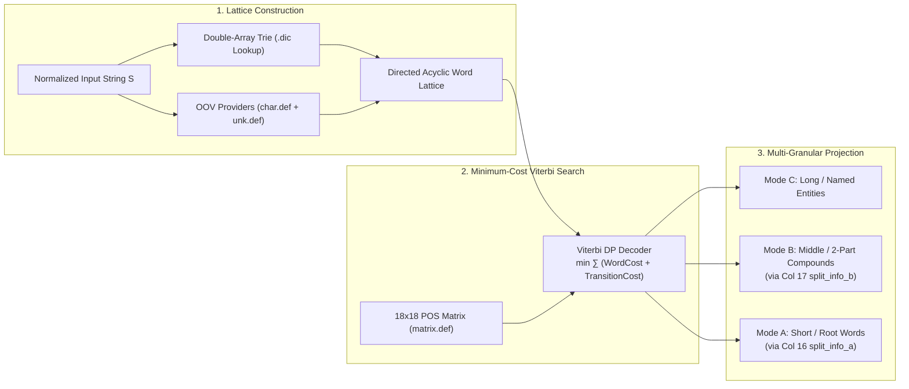
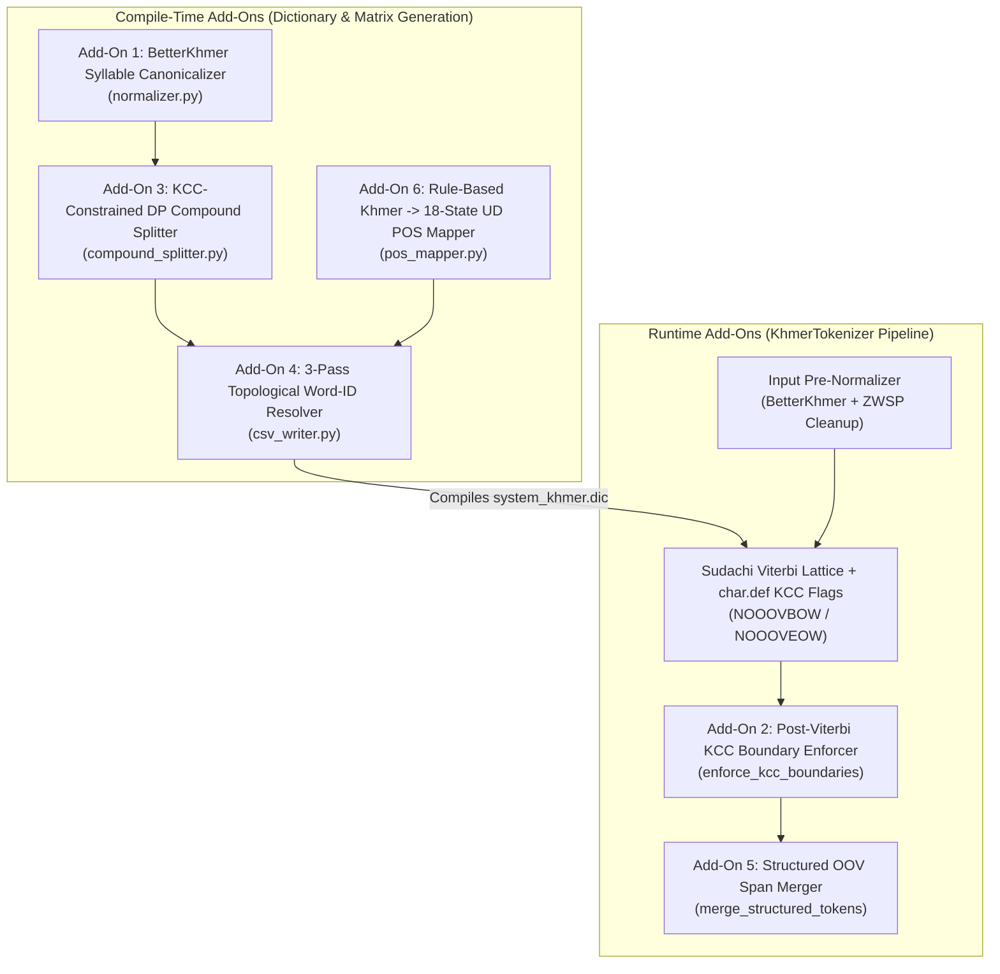
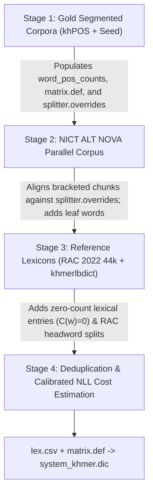

# Sudachi Architecture, Khmer Add-Ons & Multi-Dataset Ingestion Strategy (`ingestion_strategy.md`)

This document explains:
1. **How `Sudachi` (`sudachi.rs` / `SudachiPy`) works under the hood** (Double-Array Trie lattice construction, Minimum-Cost Viterbi search, and multi-granular `Mode A / B / C` projection).
2. **Why vanilla `Sudachi` cannot segment Khmer directly, and the 6 Khmer-specific add-on methods engineered in `kroch-chhmar`** (`BetterKhmer` syllable canonicalization, two-layer Khmer Character Cluster [KCC] boundary enforcement, KCC-constrained Dynamic Programming compound decomposition, 3-pass topological word-ID compilation, structured OOV span merging, and rule-based POS heuristics).
3. **How `kroch-chhmar` ingests, aligns, deduplicates, and calibrates heterogeneous Khmer datasets** into a single binary dictionary (`system_khmer.dic`) without cross-dataset probability distortion or compound granularity conflicts.

---

## 1. How Sudachi Works Under the Hood

Originally developed by Works Applications for Japanese morphological analysis, **`Sudachi`** is a high-performance, Rust-backed (`sudachi.rs`) lattice morphological analyzer. Unlike greedy maximum-matching (Longest-Match) or pure character-level neural taggers, Sudachi operates in **three deterministic steps** at runtime:

### 1.1 Step 1: Double-Array Trie Lookup & OOV Lattice Construction
Given an unsegmented input string $S = c_1 c_2 \dots c_T$, Sudachi scans every character offset $t \in [0, T)$ and constructs a directed acyclic word graph (lattice):
- **In-Vocabulary (IV) Nodes**: Using a compact **Double-Array Trie** compiled inside `system_khmer.dic` (and optional `user_khmer.dic`), Sudachi finds all dictionary entries matching substrings $S[b:e]$ starting at offset $b$. Each entry carries a `left_id` (left POS context ID), `right_id` (right POS context ID), and 16-bit signed integer `cost` (word emission cost).
- **Out-of-Vocabulary (OOV) Nodes**: At character offsets where no dictionary entry matches (or where `INVOKE=1` in [`configs/char.def`](configs/char.def)), `MeCabOovPlugin` and `SimpleOovPlugin` dynamically inject candidate OOV nodes based on character categories (`KANJI`, `NUMERIC`, `ALPHA`, `SYMBOL`) and assign fallback emission costs from [`configs/unk.def`](configs/unk.def).

### 1.2 Step 2: Minimum-Cost Viterbi Lattice Decoding
Instead of greedily picking the longest word at each step, Sudachi runs the **Viterbi algorithm** (Dynamic Programming over the lattice) to find the complete path $W = (w_1, w_2, \dots, w_k)$ from `BOS` (Beginning of Sentence) to `EOS` (End of Sentence) that minimizes the total path cost:

$$\hat{W} = \underset{W = (w_1, \dots, w_k)}{\arg\min} \sum_{i=1}^{k} \Big( \text{WordCost}(w_i, \text{POS}_i) + \text{TransitionCost}(\text{POS}_{i-1}.\text{rightId},\; \text{POS}_i.\text{leftId}) \Big)$$

- **$\text{WordCost}(w_i, \text{POS}_i)$** is stored per word in `lex.csv` (lower integer cost = higher unigram probability).
- **$\text{TransitionCost}(p_{i-1}, p_i)$** is stored in `matrix.def` and penalizes ungrammatical POS sequences (e.g., `ADP -> PUNCT`) while rewarding natural syntactic transitions (e.g., `NOUN -> VERB`, `AUX -> VERB`).

### 1.3 Step 3: Multi-Granular Projection (`Mode A`, `Mode B`, `Mode C`)
A signature feature of Sudachi is that **a single lattice search produces three segmentation granularities** without re-running the Viterbi decoder. In the 19-column Sudachi CSV schema, every compound entry stores pre-compiled 0-based word-ID pointers to its constituent sub-tokens in Column 15 (`split_type`), Column 16 (`split_info_a`), and Column 17 (`split_info_b`):
- **`Mode C` (Long / Named-Entity Granularity)**: Returns the winning Viterbi lattice nodes directly, preserving multi-word expressions, government institutions, and compound nouns (`ព្រះរាជាណាចក្រកម្ពុជា`, `ការសិក្សា`).
- **`Mode B` (Middle / Derived Compound Granularity)**: Replaces any node with `split_type == "C"` using its `split_info_b` word IDs (`ព្រះរាជាណាចក្រ | កម្ពុជា`), while keeping 2-part derived words (`ការសិក្សា`) intact.
- **`Mode A` (Short / Root Word Granularity)**: Replaces any node with `split_type in ("B", "C")` using its `split_info_a` base word IDs (`ព្រះ | រាជាណាចក្រ | កម្ពុជា`, `ការ | សិក្សា`) for high-recall search indexing and fine-grained corpora.

---

## 2. Why Vanilla Sudachi Fails on Khmer & The 6 Add-Ons in `kroch-chhmar`

Because Sudachi was designed around Japanese script (`Kanji`, `Hiragana`, `Katakana`), running vanilla Sudachi on Khmer text fails due to four fundamental orthographic and linguistic differences:
1. **Non-Unique Unicode Syllable Encoding**: Visually identical Khmer words can be typed in dozens of different codepoint orders.
2. **Complex Stacked Clusters (`KCCs`)**: Khmer syllables stack subscript consonants (`Coeng \u17d2 + Consonant`), register shifters (`៊`, `៉`), and dependent vowels (`ា..ៅ`) around a base consonant. Character-by-character OOV splitting slices right through a syllable cluster.
3. **Productive Unmarked Compounding**: Khmer forms compounds both via prefixes (`ការ-`, `ភាព-`, `សេចក្ដី-`, `អ្នក-`) and root juxtaposition without morphological inflection markers like Japanese okurigana.
4. **Mixed-Script Structured OOVs**: Punctuation rules that separate `.` or `:` from Khmer words shatter URLs (`http://abc.com`), decimals (`២.៦២៥`), clock times (`០៨:៣០`), and era abbreviations (`គ.ស.`).

To bridge this gap, **`kroch-chhmar`** wraps Sudachi's core engine with **six specialized Khmer add-on methods**:

### Add-On 1: `BetterKhmer` Finite-State Syllable Canonicalizer (`normalizer.py`)
Implemented in [`betterkhmer_normalize()`](src/kroch_chhmar/normalizer.py#L413-L468) and [`normalize_khmer()`](src/kroch_chhmar/normalizer.py#L475-L502):
- **Problem**: In Unicode Khmer, users frequently type below-vowels (`\u17bb`) before register shifters (`\u17c9`/`\u17ca`), encode `ោ` as `េ` + `ា` (`\u17c1\u17b6`), swap `Coeng Ro` (`\u17d2\u179a`) order, or insert invisible Zero-Width Spaces (`\u200b`). Any encoding mismatch causes a dictionary lookup miss.
- **How It Works**:
  1. Classifies every Khmer codepoint (`0x1780..0x17DD`) into 12 strict orthographic priority categories:
     $$\text{Base (1)} < \text{Robat (2)} < \text{Coeng (3)} < \text{Shift (4)} < \text{Z (5)} < \text{VPre (6)} < \text{VB (7)} < \text{VA (8)} < \text{VPost (9)} < \text{MS (10)} < \text{MF (11)}$$
  2. Propagates `Coeng` priority (`3`) to the immediately following consonant so `Coeng + Consonant` pairs stay attached as an atomic unit during sorting.
  3. Stable-sorts each syllable cluster and applies contextual orthographic rewrite rules:
     - Merges split compound vowels (`េ` + `ា` $\to$ `ោ`, `េ` + `ី` $\to$ `ើ`, `ើ` + `ា` $\to$ `ោី`).
     - Rewrites ambiguous `\u17bb` (*-u*) to register shifters `៊` (`\u17ca`) or `៉` (`\u17c9`) based on Series-1 (`_strong_ends`) vs. Series-2 (`_nstrong_ends`) consonant context when followed by an upper vowel/sign (`_va_samyok_at`).
     - Normalizes `Coeng Ro` (`\u17d2\u179a`) to trail other subscripts and applies context-aware phonotactic rules for `Coeng Da` / `Coeng Ta`: retroflex `ណ្ត` (`\u178e\u17d2\u178f`) $\to$ `ណ្ដ` (`\u178e\u17d2\u178a`) and dental `ន្ដ` (`\u1793\u17d2\u178a`) $\to$ `ន្ត` (`\u1793\u17d2\u178f`), while preserving etymological `្ដ`/`្ត` on other base consonants (`ក្ដៅ`, `ផ្ដើម`, `ម្ដេច`, `សេចក្ដី`).
  4. Applied identically to **all ingested dictionary/corpus entries at compile time** and **all user input strings at runtime**.

### Add-On 2: Two-Layer Khmer Character Cluster (KCC) Boundary Safeguard (`char.def` + `tokenizer.py`)
Implemented in [`configs/char.def`](configs/char.def), [`iter_kccs()`](src/kroch_chhmar/normalizer.py#L554-L586), and [`enforce_kcc_boundaries()`](src/kroch_chhmar/tokenizer.py#L76-L116):
- **Definition of a KCC**:
  $$\text{KCC} = \text{Base Consonant / Indep. Vowel} + (\text{Coeng } \text{\texttt{\textbackslash u17d2}} + \text{Subscript Base})^* + (\text{Shifter / Dependent Vowel / Sign / ZWJ / ZWNJ})^*$$
- **Layer 1 — Lattice OOV Constraints (`configs/char.def`)**:
  - Maps Khmer base consonants and independent vowels (`0x1780..0x17B3`) to `KANJI`.
  - Attaches Sudachi's **`NOOOVBOW`** (*No OOV Beginning-of-Word*) flag to all dependent vowels, shifters, and signs (`0x17B4..0x17D3`, `0x17DD`), forbidding any OOV candidate in the lattice from starting mid-cluster.
  - Attaches both **`NOOOVBOW`** and **`NOOOVEOW`** (*No OOV End-of-Word*) to `Coeng` (`0x17D2`), forbidding any OOV node from starting on a subscript marker or ending with a dangling `Coeng`.
- **Layer 2 — Post-Viterbi Safeguard (`enforce_kcc_boundaries`)**:
  - Scans the output morpheme stream and automatically merges any token that starts with a dependent character (`is_kcc_dependent_start`) or follows a trailing `\u17d2` into the preceding token, guaranteeing a **`0.00%` KCC boundary violation rate**.

### Add-On 3: Hybrid KCC-Constrained Dynamic Programming Compound Splitter (`compound_splitter.py`)
Implemented in [`CompoundSplitter`](src/kroch_chhmar/dictionary/compound_splitter.py#L25-L190):
- **Problem**: Official Khmer dictionaries (`RAC 2022 44k`) list tens of thousands of multi-syllable words without internal split annotations, which are needed to populate Sudachi's `Mode A` and `Mode B` columns.
- **How It Works**:
  1. **Curated & Corpus Overrides**: First checks explicit splits from [`configs/compounds.yaml`](configs/compounds.yaml) and `khPOS` (`_` / `~` annotations).
  2. **Productive Prefix Rule**: Checks if a word starts with `ការ-`, `ភាព-`, `សេចក្ដី-`, or `អ្នក-` followed by a verified base word on a valid KCC boundary; if so, assigns `Mode B` (`split_a = [prefix, root]`).
  3. **KCC-Constrained DP**: For longer words ($\ge 3$ KCCs), computes the minimum-cost decomposition over verified base words $V_{\text{base}}$ restricted strictly to valid KCC boundary offsets $B(w)$:
     $$D[e] = \min_{\substack{s \in B(w),\; s < e \\ (s, e) \neq (0, n) \\ w[s:e] \in V_{\text{base}}}} \Big( D[s] + \text{WordCost}(w[s:e]) + 600 \Big)$$
     Words decomposing into 2 parts ($\le 5$ KCCs) become `Mode B`; words decomposing into $\ge 3$ parts become `Mode C`. Short words ($\le 2$ KCCs) without explicit overrides remain indivisible `Mode A` base words to prevent over-fragmenting disyllabic roots.

### Add-On 4: Three-Pass Topological CSV & Word-ID Resolver (`csv_writer.py`)
Implemented in [`generate_sudachi_entries()`](src/kroch_chhmar/dictionary/csv_writer.py#L71-L286):
- **Problem**: `sudachipy build` requires `split_info_a` and `split_info_b` to reference constituent words by their **exact 0-based row index** in `lex.csv` (`0, 1, 2, ...` for system dictionaries; `U0, U1, ...` for user dictionaries). Furthermore, if a constituent surface is a pure digit string (`surf.isdigit()`), `sudachipy` misinterprets it if placed in the lookup map.
- **How It Works**:
  - **Closure Pass**: Scans all `split_a` and `split_b` lists across the lexicon and injects any missing constituent root words into the `Mode A` bucket.
  - **Pass 1 (`Mode A`)**: Emits all indivisible base words first (`rows 0 .. N_A - 1`) and records `surface -> row_id`.
  - **Pass 2 (`Mode B`)**: Emits 2-part compounds (`rows N_A .. N_B - 1`), formatting `split_info_a` as slash-separated Pass 1 IDs (e.g., `"142/891"`).
  - **Pass 3 (`Mode C`)**: Emits multi-part compounds (`rows N_B .. N_C - 1`), referencing Pass 1 IDs in `split_info_a` and Pass 2/1 IDs in `split_info_b`.
  - **User Dictionary Compatibility**: Appends a sentinel `__sudachi_default_oov__` (`名詞,普通名詞,一般,*,*,*`) at the very end of the system dictionary so `sudachipy ubuild` works out of the box without shifting any row index.

### Add-On 5: Structured OOV Span Merger (`merge_structured_tokens` in `tokenizer.py`)
Implemented in [`merge_structured_tokens()`](src/kroch_chhmar/tokenizer.py#L119-L216):
- **Problem**: Because `SYMBOL` (`:`, `/`, `.`, `,`, `-`, `@`, `#`) has `INVOKE=1, GROUP=0, LENGTH=1` in [`configs/char.def`](configs/char.def) to separate punctuation from Khmer text, Sudachi's OOV handler splits structured multi-character tokens into single characters (`http://abc.com` $\to$ `http | : | / | / | abc | . | com`, `២.៦២៥` $\to$ `២ | . | ៦២៥`, `...` $\to$ `. | . | .`).
- **How It Works**:
  - Matches structured entity spans `[span_start, span_end)` on the normalized input string via [`_STRUCTURED_SPAN_RE`](src/kroch_chhmar/tokenizer.py#L17-L28):
    - **URLs & Web Paths (`SYM`)**: `http://abc.com`, `https://mptc.gov.kh/news?id=12`, `www.moe.gov.kh` (automatically stopping before unspaced Khmer characters `0x1780..0x17FF` and stripping trailing sentence punctuation while preserving trailing ellipses).
    - **Emails & Bare Domains (`SYM` / `PROPN`)**: `info@rac.edu.kh`, `abc.com`.
    - **Formatted Numbers, Decimals, Thousands & Clock Times (`NUM`)**: `២.៦២៥`, `១,៧៥`, `1,250.50`, `០៨:៣០`.
    - **Dotted Abbreviations & Peyyal (`PROPN` / `PUNCT`)**: `គ.ស.`, `ព.ស.`, `U.S.A.`, `។ល។`.
    - **Hyphenated Alphanumerics & Social Tags (`PROPN` / `SYM`)**: `COVID-19`, `កូវីដ-១៩`, `Wi-Fi`, `#Khmer2026`, `@moh_kh`.
    - **Ellipses & Repeated Punctuation (`PUNCT`)**: `...`, `…`, `?!`, `!!`.
  - Aligns `[span_start, span_end)` with morpheme `begin`/`end` offsets in $O(N)$ time and merges contiguous sub-tokens into a single `KhmerMorpheme`.

### Add-On 6: Unified 18-State UD POS Mapper & Minority Tag Pruning (`pos_mapper.py` & `cost_estimator.py`)
Implemented in [`map_to_ud_pos()`](src/kroch_chhmar/dictionary/pos_mapper.py) and [`finalize_deduplication()`](src/kroch_chhmar/dictionary/cost_estimator.py#L165-L226):
- Maps 40+ heterogeneous corpus/dictionary tags (`khPOS` Penn-style tags `NN`, `VB`, `JJ`, `PA`, `PRO`, `M`; `NICT ALT` tags `n`, `v`, `a`, `o`, `1`; and `RAC 2022` Khmer grammatical abbreviations `ន.`, `កិ.`, `គុ.`) into the **17 Universal Dependencies (`UD`) POS tags (`IDs 0..16`)** plus state `17` (`KHMER_DEP_POS_ID`).
- Prunes noisy minority POS tags from human corpus tagging errors when a word has a clear dominant POS ($\max \text{count} \ge 10$ and minority share $< 10\%$), reducing compiled dictionary size by ~19% and sharpening POS transition probabilities.

### Add-On 7: Coeng DA (`្ដ`) / Coeng TA (`្ត`) Visual Twin Alias Generation & RAC 2022 Harmonization (`normalizer.py`, `cost_estimator.py`, `csv_writer.py`)
Implemented in [`_coeng_da()`](src/kroch_chhmar/normalizer.py#L335-L360), [`generate_coeng_twins()`](src/kroch_chhmar/normalizer.py#L540-L556), [`finalize_deduplication()`](src/kroch_chhmar/dictionary/cost_estimator.py#L165-L226), and [`generate_sudachi_entries()`](src/kroch_chhmar/dictionary/csv_writer.py#L71-L384):
- **Problem**: In Khmer fonts, the subscript glyphs of **`ដ`** (`្ដ`, `\u17d2\u178a`) and **`ត`** (`្ត`, `\u17d2\u178f`) look visually identical, causing typists and datasets to interchange them (e.g., `NICT ALT NOVA` collapsed all `្ដ` to `្ត` with `0` `្ដ` vs `20,207` `្ត`, whereas `RAC 2022` strictly distinguishes `14,483` `្ដ` and `17,810` `្ត`).
- **How It Works**:
  1. **Context-Aware Phonotactic Pre-Normalization**: Automatically repairs phonotactically illegal clusters (`ណ្ត` $\to$ `ណ្ដ` for retroflex `ណ`, e.g., `កណ្ដាល`, `កណ្ដុរ`; and `ន្ដ` $\to$ `ន្ត` for dental `ន`, e.g., `សន្តិភាព`, `អន្តរជាតិ`) while preserving etymological `្ដ`/`្ត` on other base consonants.
  2. **RAC 2022 Ground-Truth Frequency Pooling**: Registers official `RAC 2022` headwords (`is_canonical=True`) by their `coeng_skeleton()` and pools unigram frequencies from `khPOS` and `NICT ALT NOVA` onto the canonical `RAC 2022` form (`ក្ដៅ`, `ផ្ដើម`, `ម្ដេច`, `សេចក្ដី`, `ស្ដាប់`).
  3. **Dual-Entry Visual Twin Aliases in `lex.csv`**: Emits both the canonical `RAC 2022` entry and its visual twin alias across Mode A, Mode B, and Mode C passes, with Column 13 (`normalized_form`) pointing to the canonical `RAC 2022` spelling. At runtime, users typing either `ក្ដៅ` or `ក្តៅ` get an exact $O(1)$ Double-Array Trie hit (`m.surface`) and receive the official `RAC 2022` spelling in `m.normalized_form`.

---

## 3. Overview of Ingested Datasets

`kroch-chhmar` combines **four public Khmer lexical and corpus resources** (plus the built-in `data/seed/` dataset), which fall into two distinct categories:

| Dataset Key | Source | Size | Category | Primary Role in `kroch-chhmar` |
| :--- | :--- | :--- | :--- | :--- |
| **`khpos`** | [`ye-kyaw-thu/khPOS`](https://github.com/ye-kyaw-thu/khPOS) | `12,000` train sents (`+ 2,000` held-out test sents) | **Gold Annotated Corpus** | Defines canonical Khmer compound boundaries (`_`, `~`, `^`), unigram word counts $C(w)$, and POS bigram transitions (`matrix.def`). |
| **`alt-khmer`** | NICT / NIPTICT Asian Language Treebank (`km-nova-181101`) | `20,106` sents (`~26.7k` unique words) | **Gold Annotated Corpus** | Expands sentence-level unigram counts $C(w)$, 18×18 UD POS transition probabilities, and verified leaf-word vocabulary. |
| **`rac-dict`** | Royal Academy of Cambodia Dictionary 2022 (`seanghay/khmer-dictionary-44k`) | `44,693` headwords & subwords | **Gold Orthography Lexicon** | Provides official Khmer headwords (`t_main`), derived compounds (`t_subword`), POS tags (`t_pos`), and phonetic readings (`t_pron`). |
| **`khmerlbdict`** | [`silnrsi/khmerlbdict`](https://github.com/silnrsi/khmerlbdict) (`KHOV`, `KHSV`, `seafreq`, `names`, `places`, `villages`, etc.) | `~78,940` rows | **Broad-Coverage Wordlist** | Provides out-of-domain lexical coverage and proper nouns (`PROPN`) for rare words not seen in news corpora. |

---

## 4. Three-Stage Ingestion Order (`kroch-chhmar prepare`)

Because different datasets annotate compound words at different granularities, [`cmd_prepare()`](src/kroch_chhmar/cli.py) ingests raw datasets in a strict **three-stage order**:

### Stage 1: Canonical Segmented Corpora (`khPOS` & `seed`)
Implemented in [`ingest_segmented_text_file()`](src/kroch_chhmar/ingest/local_importers.py):
1. **Derivational Suffix Marker (`^`) Stripping**:
   - In `khPOS`, `^` marks a bound Pali/Sanskrit derivational suffix (`សេដ្ឋ^កិច្ច`, `ពាណិជ្ជ^កម្ម`, `ជីវ^ភាព`, `កសិ^កម្ម`).
   - Because the stem preceding `^` (`សេដ្ឋ-`, `កសិ-`, `ឧស្សាហ-`) is a bound root rather than an independent Khmer word, `^` is stripped immediately so `សេដ្ឋ^កិច្ច` normalizes to `សេដ្ឋកិច្ច`. This merges its frequency with other corpora and prevents bound stems from polluting `CompoundSplitter.base_vocab`.
2. **Compound & Prefix Markers (`_` and `~`)**:
   - Tokens linked by `_` (lexical compounds like `ធម្ម_ជាតិ`, `ព្រៃ_ឈើ`) or `~` (prefix/title compounds like `លោក~ស្រី`, `ការ~សិក្សា`) are registered as:
     - **Full surface form** (`ធម្មជាតិ`, `លោកស្រី`) in the sentence stream (`Mode B` if 2 parts, `Mode C` if $\ge 3$ parts) inside `splitter.overrides`.
     - **Constituent base words** (`ធម្ម`, `ជាតិ`, `លោក`, `ស្រី`) in `splitter.base_vocab` so `Mode A` decomposes them cleanly into root words.
3. **Held-Out Evaluation Protection**:
   - `khpos_open_test.pos` and `khpos_close_test.pos` are automatically skipped during default `kroch-chhmar prepare` so benchmark evaluations remain strictly held out.

### Stage 2: Compound-Aligned `NICT ALT NOVA` Ingestion
Implemented in [`ingest_alt_nova_files()`](src/kroch_chhmar/ingest/local_importers.py):
- `data_km.km-tag.nova` uses bracketed tags (`n[n n n]n`) that frequently span **entire syntactic noun phrases** (e.g., `រដ្ឋាភិបាលកម្ពុជា` *"Government of Cambodia"*, `ប្រទេសកម្ពុជា` *"Country of Cambodia"*), rather than single lexical compounds.
- To prevent syntactic noun phrases from receiving high single-token corpus counts and over-merging independent words in Modes B and C:
   - Every leaf word in `data_km.km-tok.nova` is registered in `splitter.base_vocab` with its inner POS tag.
   - When a bracketed chunk `outer[inner_1 ... inner_k]outer` is encountered, its joined surface is emitted as a single compound token **only if it matches an established lexical compound in `splitter.overrides`** (from Stage 1 or `configs/compounds.yaml`); otherwise, its individual leaf words are emitted into the sentence stream.

### Stage 3: Authoritative Lexicons & Broad-Coverage Wordlists (`RAC 2022` & `khmerlbdict`)
Implemented in [`ingest_rac_dictionary_csv()`](src/kroch_chhmar/ingest/local_importers.py) and [`ingest_lexicon_tsv()`](src/kroch_chhmar/ingest/local_importers.py):
- **Royal Academy of Cambodia (`RAC-Khmer-Dict-2022.csv`)**:
  - Extracts official headwords (`t_main`), subwords (`t_subword`), POS tags (`t_pos`), and phonetic pronunciations (`t_pron`).
  - Only `t_main` headwords (and verified `t_subword` prefixes) are added to `splitter.base_vocab` for Mode A decomposition.
- **`khmerlbdict` (`khmerlbdict_*.tsv`)**:
  - Proper-noun lists (`names`, `places`, `villages`) are mapped to `PROPN`.
  - Raw unsegmented corpus frequency numbers (`seafreq`, `KHOV`, `KHSV`) are **ignored (`freq = 0`)** so they do not distort sentence-corpus probability estimation (see Section 5.1).
  - Unverified `khmerlbdict` surface strings are added to the dictionary as lexicon entries, but are **excluded from `splitter.base_vocab`** so noisy 1-syllable fragments cannot shatter multi-syllable loanwords during Mode A Dynamic Programming decomposition.

---

## 5. Mathematical Cost Calibration (`cost_estimator.py`)

When `SudachiPy` tokenizes a sentence, its Viterbi search selects the path $w_1, w_2, \dots, w_k$ that minimizes the sum of word emission costs (`lex.csv`) and POS bigram transition costs (`matrix.def`):

$$\text{TotalCost}(w_1 \dots w_k) = \sum_{i=1}^{k} \text{WordCost}(w_i, \text{POS}_i) + \sum_{i=1}^{k} \text{TransitionCost}(\text{POS}_{i-1}, \text{POS}_i)$$

### 5.1 Protecting Corpus Probability $P(w)$ from Uncalibrated Wordlist Counts
For any word $w$ attested $C(w) > 0$ times in the human-segmented sentence corpora (`khPOS` + `NICT ALT`), its emission cost is computed via smoothed Negative Log-Likelihood (NLL) in [`estimate_word_cost()`](src/kroch_chhmar/dictionary/cost_estimator.py):

$$\text{WordCost}(w, \text{POS}) = \text{round}\!\left(-500 \cdot \ln\frac{C(w, \text{POS}) + 0.5}{N + 0.5 V}\right)$$

where:
- $N = \text{total\_corpus\_tokens} \approx 540,000$ (from the `32,046` deduplicated `khPOS` + `NICT ALT` sentences),
- $V = \text{vocab\_size} \approx 82,587$.

> [!IMPORTANT]
> **Why unsegmented wordlist frequencies (`khmerlbdict`) must not be added to $N$:**
> `khmerlbdict` (`seafreq`, `KHSV`, `KHOV`) contains $8,643,616$ raw counts—**16× larger** than $N$. Adding those counts into $N$ divides every real `khPOS`/`ALT` word's probability by 16, adding a constant $+500 \cdot \ln(16) \approx +1,386$ penalty to every corpus word and pushing rare corpus words ($6,500 \to 7,886$) above the OOV threshold ($7,500$). Keeping external wordlists at $C(w) = 0$ preserves exact sentence-corpus NLL probabilities.

Under this calibrated scale:
- **High-frequency corpus words** ($C = 1,000$, e.g. `នៅ`, `ក្នុង`, `មាន`): $\text{WordCost} \approx \mathbf{3,180}$
- **Medium-frequency corpus words** ($C = 20$, e.g. `ព្រៃឈើ`, `តំបន់`): $\text{WordCost} \approx \mathbf{5,120}$
- **Single-occurrence corpus words** ($C = 1$): $\text{WordCost} \approx \mathbf{6,500}$
- **OOV (unknown) fallback tokens** (`configs/unk.def`): $\text{WordCost} = \mathbf{7,500 - 7,800}$

---

### 5.2 KCC-Length-Scaled Cost for Unattested Dictionary Words ($C(w) = 0$)

Roughly half of the entries in `system_khmer.dic` come from `RAC 2022 44k` and `khmerlbdict` and never appear in the `32,046` training sentences ($C(w) = 0$).

If unattested multi-word entries were given a flat low cost (e.g. $5,200$) or a length discount, an unattested 2-word entry $w_{12}$ ($5,200$) would always undercut two legitimate medium-frequency corpus words $w_1 + w_2$ ($5,000 + 5,000 = 10,000$), causing rampant over-merging.

Instead, [`estimate_word_cost()`](src/kroch_chhmar/dictionary/cost_estimator.py) assigns unattested dictionary entries ($C(w) = 0$) a **KCC-length-scaled cost**:

$$\text{UnseenCost}(w) = \min\!\big(15000,\; 7200 + 500 \cdot (\text{KCCs}(w) - 1)\big)$$

where $\text{KCCs}(w)$ is the number of Khmer Character Clusters in $w$:
- **1 KCC unseen word**: $7,200$ (just below OOV cost $7,500$)
- **2 KCC unseen word**: $7,700$
- **3 KCC unseen word**: $8,200$
- **4 KCC unseen word**: $8,700$

**Why this guarantees optimal Viterbi behavior:**
1. **When constituent words are attested in the corpus**:
   - Suppose the input is `តំបន់ព្រៃឈើ` ("forest area"), where `តំបន់` ($C > 0$, cost $4,600$) and `ព្រៃឈើ` ($C > 0$, cost $4,800$) are attested corpus words (total path cost $= \mathbf{9,400}$), while `តំបន់ព្រៃ` is an unattested 3-KCC entry ($C = 0$, cost $8,200$) followed by `ឈើ` ($4,500$, total path cost $= \mathbf{12,700}$).
   - Because $9,400 < 12,700$, the Viterbi lattice cleanly selects the attested corpus words **`តំបន់ | ព្រៃឈើ`**.
2. **When a rare word or proper noun is genuinely unseen in the corpus**:
   - Suppose the input is a rare 3-KCC dictionary word or proper name whose syllables are *not* standalone corpus words.
   - Without the dictionary entry, `SudachiPy` would have to segment it into multiple OOV chunks costing $7,500 + 7,500 = \mathbf{15,000}$.
   - With the dictionary entry at $\text{UnseenCost}(w) = \mathbf{8,200} < 15,000$, the dictionary entry wins and prevents an OOV split.

---

## 6. Impact of Calibration & Add-Ons on Held-Out Benchmark Accuracy

The table below shows the ablation and calibration impact on the `khPOS` `OPEN-TEST` and `CLOSE-TEST` benchmarks (with both test sets strictly held out from `system_khmer.dic`):

| Configuration | Dictionary Entries | `OPEN-TEST` Mode C (`--join-compounds`) | `OPEN-TEST` Mode B (`--join-compounds`) | `OPEN-TEST` Mode A (`--split-compounds`) | `CLOSE-TEST` Mode C (`--join-compounds`) | `OPEN-TEST` OOV Rate |
| :--- | :---: | :---: | :---: | :---: | :---: | :---: |
| **Uncalibrated 4-Dataset Build** *(raw `khmerlbdict` counts + unseen length discount + unaligned `ALT` NPs)* | 99,797 | 84.01% | 82.27% | 85.68% | 84.37% | 3.72% |
| **Calibrated 4-Dataset Build** *(Stages 1–3 + KCC-scaled unseen cost + clean `base_vocab`)* | **81,921** | 94.82% | 91.89% | 92.00% | **96.27%** | 2.81% *(Mode C)* / 2.32% *(Mode A)* |
| **+ Structured OOV Span Merger (`merge_structured_tokens`)** *(URLs, decimals `២.៦២៥`, times `០៨:៣០`, `គ.ស.`, `...`)* | **81,921** | **94.85%** *(78.6% exact sent)* | **91.93%** | **92.04%** *(67.9% exact sent)* | **96.25%** *(85.6% exact sent)* | **2.65%** *(Mode C)* / **2.19%** *(Mode A)* |
| **Total Improvement** | — | **+10.84% F1** | **+9.66% F1** | **+6.36% F1** | **+11.88% F1** | **-1.07% OOV** |
