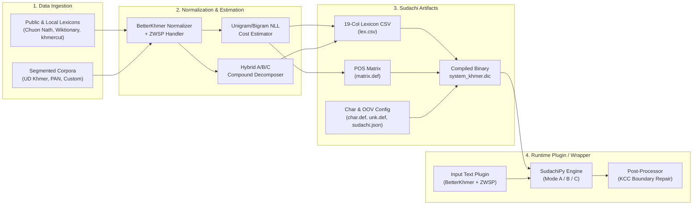

# Sudachi-Khmer: Dictionary Generation Workflow & Segmentation Plugin Plan

## 1. Architecture Overview

`sudachi-khmer` provides an end-to-end Python pipeline (`uv` + `pyproject.toml`) to build a **Sudachi-compatible Khmer binary dictionary** (`system_khmer.dic` & `user_khmer.dic`) and a **Khmer-aware SudachiPy tokenizer wrapper/plugin** that handles Khmer Unicode canonicalization and Khmer Character Cluster (KCC) constraints.



---

## 2. Key Design Decisions

### 2.1 Target Runtime & Plugin Architecture
- **Engine**: `SudachiPy` (`>=0.6.8`) using its CLI dictionary builders (`sudachipy build` and `sudachipy ubuild`).
- **Config-Driven Core Plugins**:
  - `char.def` defines Khmer character categories (`KHMER_BASE`, `KHMER_DEP`, `KHMER_DIGIT`, `KHMER_PUNCT`) alongside standard ASCII/Unicode categories.
  - `unk.def` configures OOV costs and POS mappings, assigning high transition penalties to dangling `KHMER_DEP` (coeng/dependent vowels) so the Viterbi lattice avoids splitting inside clusters.
  - `sudachi.json` wires `DefaultInputTextPlugin`, `MeCabOovProviderPlugin`, and `SimpleOovProviderPlugin`.
- **Python Preprocessing & KCC Safeguard Wrapper (`KhmerTokenizer`)**:
  - **Pre-tokenization**: Runs `betterkhmer` canonicalization (sorting syllable components, merging compound vowels like `េ` + `ា` $\to$ `ោ`, resolving consonant shifters) and handles zero-width characters (`\u200b`, `\u200c`, `\u200d`).
  - **Post-tokenization**: Enforces **Khmer Character Cluster (KCC)** boundaries by automatically merging any adjacent OOV or dictionary tokens if a split point falls on a dependent vowel, coeng (`\u17d2`), or diacritic.

### 2.2 POS Tagset & `matrix.def`
- **Universal Dependencies (UD) Tagset**: Maps Khmer POS tags to the 17 UD core tags (`NOUN`, `PROPN`, `VERB`, `ADJ`, `ADV`, `PRON`, `DET`, `ADP`, `NUM`, `CCONJ`, `SCONJ`, `PART`, `AUX`, `INTJ`, `PUNCT`, `SYM`, `X`), padded to Sudachi's 6 POS columns (e.g., `NOUN,*,*,*,*,*`).
- **Statistical Cost Estimation**:
  - **Emission Cost (`cost`)**: Negative log-likelihood $\text{round}(-c \cdot \ln P(w \mid t))$ with Laplace/Good-Turing smoothing for lexicon words unseen in the segmented corpus.
  - **Transition Cost (`matrix.def`)**: Bigram POS transition costs $\text{round}(-c \cdot \ln P(t_i \mid t_{i-1}))$ estimated from tagged/segmented corpora, plus a dedicated high-cost state for `KHMER_DEP` OOVs.

### 2.3 Multi-Granular Segmentation (Modes A, B, C)
- **Mode A (Short / Root words)**: Base words and indivisible roots (`word_structure` column 3 = `A`).
- **Mode B (Middle / Common compounds)**: Derived words (e.g., prefixes `ការ-`, `ភាព-`, `អ្នក-` + root) and high-frequency 2-part compounds.
- **Mode C (Long / Named Entities & Phrases)**: Multi-word expressions, idioms, and proper nouns.
- **Hybrid Decomposition Engine**:
  1. **Curated Overrides (`configs/compounds.yaml`)**: Explicit A/B/C split definitions for common prefixes, suffixes, and irregular compounds.
  2. **Automated DP / Viterbi Splitter**: Decomposes multi-syllable dictionary words into known base words (`A` units) when all sub-parts exist in the base vocabulary and satisfy minimum KCC length constraints, populating Sudachi CSV columns `split_info_a` (Col 15) and `split_info_b` (Col 16).

### 2.4 Sudachi 19-Column CSV Mapping for Khmer
| Col | Field | Khmer Value |
| :--- | :--- | :--- |
| 0 | `surface` | Normalized Khmer surface string (via `betterkhmer`) |
| 1-2 | `left_id`, `right_id` | POS ID corresponding to `matrix.def` (`-1` for auto-lookup if user dict) |
| 3 | `cost` | Corpus NLL word cost |
| 4 | `display_surface` | Identical to `surface` |
| 5-10 | `pos1`..`pos6` | UD POS tag + `*,*,*,*,*` (e.g., `NOUN,*,*,*,*,*`) |
| 11 | `reading_form` | Identical to `surface` by default (optional IPA lookup hook) |
| 12 | `normalized_form` | Canonical `betterkhmer` form |
| 13 | `dictionary_form_word_id` | `*` |
| 14 | `split_type` | `A` (base word), `B` (middle compound), or `C` (long compound) |
| 15 | `split_info_a` | `*` or slash-separated Mode A constituent references (e.g., `0/1` or inline rows) |
| 16 | `split_info_b` | `*` or slash-separated Mode B constituent references |
| 17 | `unused` | `*` |

---

## 3. Project Directory Structure

```text
sudachi-khmer/
├── pyproject.toml                 # Dependencies (sudachipy, betterkhmer, typer, rich, pyyaml)
├── README.md
├── plan/
│   └── implementation_plan.md     # Architectural design & implementation plan
├── configs/
│   ├── char.def                   # Khmer Unicode blocks + KCC categories
│   ├── unk.def                    # OOV definitions per character category
│   ├── rewrite.def                # Input rewrite rules
│   ├── sudachi.json               # SudachiPy dictionary & plugin configuration
│   └── compounds.yaml             # Curated prefix/suffix rules & compound split overrides
├── data/
│   ├── seed/                      # Built-in seed lexicon & segmented corpus for immediate builds
│   ├── raw/                       # Downloaded & local raw lexicons/corpora
│   ├── interim/                   # Normalized wordlists, extracted unigrams/bigrams
│   └── build/                     # Generated matrix.def, lex.csv, system_khmer.dic
├── src/
│   └── sudachi_khmer/
│       ├── __init__.py
│       ├── cli.py                 # CLI entrypoints: fetch, prepare, build, ubuild, tokenize, evaluate
│       ├── normalizer.py          # BetterKhmer integration, ZWSP handling, KCC regex/parser
│       ├── ingest/
│       │   ├── __init__.py
│       │   ├── public_datasets.py # Fetchers for khmer-nltk/khmercut, UD Khmer, Wiktionary
│       │   └── local_importers.py # Importers for CoNLL-U, segmented text, CSV/TSV
│       ├── dictionary/
│       │   ├── __init__.py
│       │   ├── pos_mapper.py      # Maps raw POS tags to UD 6-tuple & matrix IDs
│       │   ├── cost_estimator.py  # Unigram/bigram NLL cost & matrix.def generator
│       │   ├── compound_splitter.py # Hybrid rule + DP decomposition for Mode A/B/C
│       │   └── csv_writer.py      # Formats and validates 19-column Sudachi CSV + ubuild support
│       ├── tokenizer.py           # KhmerTokenizer wrapper (Pre-norm + SudachiPy + KCC Post-repair)
│       └── evaluate.py            # Precision/Recall/F1/OOV benchmark + baseline comparison
└── tests/
    ├── test_normalizer_kcc.py
    ├── test_compound_splitter.py
    ├── test_csv_builder.py
    └── test_tokenizer_e2e.py
```

---

## 4. Implementation Steps

1. **Project Initialization & Configuration (`configs/` & `pyproject.toml`)**:
   - Initialize `pyproject.toml` with `sudachipy`, `betterkhmer` (or pure-Python port), `typer`, `pyyaml`, and `pytest`.
   - Author `configs/char.def`, `configs/unk.def`, `configs/rewrite.def`, `configs/sudachi.json`, and `configs/compounds.yaml`.
2. **Khmer Normalizer & KCC Engine (`normalizer.py`)**:
   - Implement `normalize_khmer()` wrapping `betterkhmer` and zero-width space cleanup.
   - Implement `iter_kccs()` and `is_kcc_boundary()` to detect Khmer Character Cluster boundaries (`Consonant/Independent Vowel + [Coeng + Subscript]* + [Register Shifter] + [Dependent Vowel]* + [Signs]*`).
3. **Data Ingestion (`ingest/`)**:
   - Implement importers for local segmented files (space/ZWSP-delimited, CoNLL-U, CSV/TSV) and automated fetchers for open Khmer wordlists/corpora, plus a built-in seed dataset so the pipeline can build and test out-of-the-box immediately.
4. **Statistical Cost Estimator & Compound Decomposer (`dictionary/`)**:
   - Implement `cost_estimator.py` to compute smoothed NLL emission costs and generate `matrix.def`.
   - Implement `compound_splitter.py` for Mode A/B/C split resolution using two-pass CSV generation (writing Mode A base words first so Mode B/C entries can reference their line numbers).
   - Implement `csv_writer.py` and wrapper around `sudachipy build` / `sudachipy ubuild`.
5. **Runtime Tokenizer & KCC Post-Processor (`tokenizer.py`)**:
   - Implement `KhmerTokenizer` supporting Modes `A`, `B`, `C`, pre-normalization, and post-tokenization KCC repair.
6. **CLI & Evaluation Suite (`cli.py`, `evaluate.py`, `tests/`)**:
   - Build CLI commands (`sudachi-khmer fetch|prepare|build|ubuild|tokenize|evaluate`).
   - Write end-to-end tests compiling a seed `system_khmer.dic` and verifying segmentation across Modes A, B, and C, OOV handling, and KCC boundary preservation.
